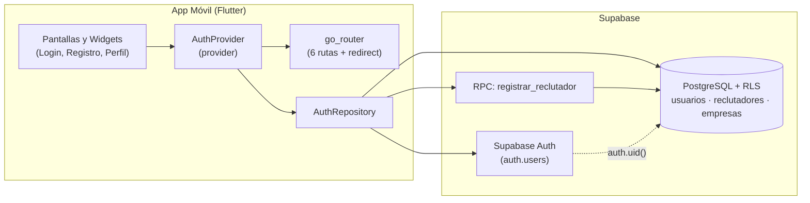

# DreamJob

Aplicación móvil de búsqueda de empleo y prácticas profesionales con dinámica de match bidireccional.


-amber)

---

## 1. Descripción y propuesta de valor

**DreamJob** es una aplicación móvil en **Flutter/Dart** que lleva la mecánica de **Tinder** al mercado laboral y de prácticas universitarias.

En lugar de enviar hojas de vida a decenas de portales sin recibir respuesta, el flujo se basa en interés mutuo:

1. Cada persona crea un perfil con sus datos y preferencias; por su parte, los reclutadores registran su empresa y publican vacantes o prácticas.
2. En la pantalla de búsqueda se muestran tarjetas con oportunidades que encajan con el perfil (o candidatos compatibles, en el caso de las empresas).
3. Deslizar a la **derecha** indica interés (*like*) y deslizar a la **izquierda** descarta la tarjeta.
4. Solo hay **match** cuando ambas partes se dan *like* mutuamente (match bidireccional entre candidato y empresa).

**Visión a largo plazo (Roadmap):** a partir del modelo de datos diseñado para el proyecto, las siguientes etapas contemplan un agente de IA que ayude con vacantes y postulaciones (ajuste de hoja de vida y carta de presentación, llenado de formularios, lectura de códigos OTP 2FA y registro de acciones), además de seguimiento de postulaciones y entrevistas, sesiones de preparación con un coach y notificaciones.

---

## 2. Usuarios objetivo

### Valentina Rodríguez — Candidata
- **Perfil:** 21 años, Cali, Colombia. Estudiante de Ingeniería de Sistemas orientada a desarrollo móvil.
- **Contexto:** *"Quiero encontrar una oportunidad que se ajuste a mi perfil sin enviar mi hoja de vida a decenas de vacantes que no responden."*
- **Motivaciones:** conseguir su primera práctica o empleo junior, aplicar Flutter, Dart y sus proyectos académicos en un entorno real, y dar con empresas cuya modalidad, horarios y cultura se ajusten a lo que busca.
- **Frustraciones:** vacantes junior que piden años de experiencia, procesos donde nunca informan el estado de la postulación y ofertas sin datos claros de salario, modalidad o beneficios.

### Andrés Martínez — Reclutador
- **Perfil:** 32 años, Cali, Colombia. Analista de selección tecnológica.
- **Contexto:** *"Necesito identificar candidatos realmente compatibles sin invertir horas revisando perfiles que no cumplen los requisitos básicos."*
- **Motivaciones:** cubrir vacantes de prácticas y cargos junior con rapidez, revisar habilidades, disponibilidad y preferencias antes de primer contacto, y tener en un solo lugar las vacantes, perfiles, matches y mensajes.
- **Frustraciones:** recibir decenas de postulaciones que no cumplen requisitos mínimos, tener la información repartida entre portales, correo y hojas de cálculo, y encontrar perfiles incompletos difíciles de comparar.

---

## 3. Funcionalidades

El repositorio está actualmente en el **Sprint 1 (Autenticación)**. Lo que pertenece a esta entrega figura como **En desarrollo** hasta completar la integración en `dev` y `main`; el resto corresponde al **Roadmap** derivado del modelo de datos.

| Funcionalidad | Estado | Detalle |
|---|---|---|
| Registro de candidato con onboarding básico | En desarrollo (Sprint 1) | Nombre, correo, contraseña, ciudad, fecha de nacimiento y resumen opcional |
| Registro de reclutador con empresa nueva | En desarrollo (Sprint 1) | Datos del reclutador y alta transaccional de su empresa (nombre, descripción y monograma) por RPC |
| Inicio de sesión con correo y contraseña | En desarrollo (Sprint 1) | Autenticación con Supabase Auth (sin confirmación de correo) y mensajes de error en español |
| Resumen de perfil según rol | En desarrollo (Sprint 1) | Vista diferenciada para candidato (incluye edad calculada) y reclutador (incluye tarjeta de empresa) |
| Sesión persistente y cierre de sesión | En desarrollo (Sprint 1) | El Splash verifica la sesión guardada y redirige a `/profile` o `/login` |
| Seguridad por fila (RLS) en Postgres | En desarrollo (Sprint 1) | Políticas RLS en `empresas`, `usuarios` y `reclutadores` más la función `registrar_reclutador` |
| Inicio de sesión con Google y conexión con Gmail | Roadmap | Fuera del Sprint 1 (`google_sub` y tokens OAuth) |
| Preferencias laborales, tecnologías y hojas de vida | Roadmap | Seniority, salario mínimo, modalidades, stack técnico, empresas bloqueadas y puntaje ATS |
| Publicación de vacantes y recomendaciones | Roadmap | Ofertas por empresa, puntos clave y sugerencias con razones de compatibilidad |
| Swipes y match bidireccional | Roadmap | Deslizar a derecha/izquierda tanto para candidatos como para empresas, con opción de deshacer |
| Agente de IA para postulaciones y documentos | Roadmap | Adaptación de CV y carta de presentación, respuestas de formulario, códigos OTP 2FA y bitácora |
| Seguimiento de postulaciones, entrevistas y coach | Roadmap | Estados de aplicación, agenda de entrevistas y sesiones de práctica con puntaje y consejos |
| Notificaciones | Roadmap | Avisos en la app para candidatos y reclutadores |

---

## 4. Arquitectura y stack

### Stack utilizado en el Sprint 1
- **Aplicación móvil:** Flutter / Dart (canal estable).
- **Estado:** `provider` (`ChangeNotifier` mediante `AuthProvider`).
- **Rutas y navegación:** `go_router` con redirección automática según el estado de sesión.
- **Backend:** Supabase (`supabase_flutter`)
  - **Auth:** correo y contraseña con confirmación de email desactivada.
  - **Base de datos:** PostgreSQL con Row Level Security (RLS) activo por `auth.uid()`.
  - **RPC `registrar_reclutador`:** función en PL/pgSQL (`security definer`) para insertar empresa y reclutador en una misma transacción.

### Diagrama de arquitectura



---

## 5. Modelo de datos

Sobre el diseño de base de datos del proyecto conviene tener presentes tres puntos:

1. **Modelo objetivo vs. alcance actual:** el diagrama relacional completo recoge la visión objetivo del producto a largo plazo. En el **Sprint 1 solo se implementan las tablas `empresas`, `usuarios` y `reclutadores`** (enlazadas a `auth.users` de Supabase) junto con la función RPC `registrar_reclutador`.
2. **Tipos de datos:** el diagrama original se modeló con tipos de **Oracle** (`VARCHAR2`, `NUMBER`, `CLOB`, `DATE`, `TIMESTAMP`), pero la base de datos real corre sobre **PostgreSQL en Supabase** (`uuid`, `text`, `date`, `timestamptz`, `boolean`, `numeric`).
3. **Aislamiento:** todas las tablas del Sprint 1 tienen RLS habilitado; el alta de empresa y reclutador no admite `INSERT` directo desde el cliente y se hace únicamente mediante la función RPC.

### 5.1. Tablas del Sprint 1 (PostgreSQL en Supabase)

| Tabla / Función | Columnas principales | Reglas RLS / Permisos |
|---|---|---|
| `empresas` | `id` (`uuid PK default gen_random_uuid()`), `nombre` (`text not null`), `descripcion` (`text`), `monograma` (`text not null`), `created_at` (`timestamptz`) | `SELECT` limitado a la empresa del reclutador autenticado. Sin `INSERT` directo. |
| `usuarios` | `id` (`uuid PK references auth.users(id) on delete cascade`), `nombre` (`text not null`), `email` (`text not null`), `ciudad` (`text not null`), `fecha_nacimiento` (`date not null`), `resumen_perfil` (`text`), `created_at` (`timestamptz`) | `SELECT`, `INSERT` y `UPDATE` solo cuando `id = auth.uid()`. |
| `reclutadores` | `id` (`uuid PK references auth.users(id) on delete cascade`), `nombre` (`text not null`), `email` (`text not null`), `empresa_id` (`uuid not null references empresas(id)`), `created_at` (`timestamptz`) | `SELECT` y `UPDATE` solo cuando `id = auth.uid()`. Sin `INSERT` directo. |
| `registrar_reclutador` (RPC) | `p_nombre`, `p_email`, `p_empresa_nombre`, `p_empresa_descripcion`, `p_empresa_monograma` (`text`) | `security definer`, `set search_path = public`. Valida `auth.uid()`, crea la empresa y el reclutador en una transacción. Ejecución permitida solo a `authenticated`. |

### 5.2. Entidades del modelo completo (Visión objetivo)

| Bloque | Tablas en el modelo relacional | Uso dentro del sistema |
|---|---|---|
| Perfil del candidato | `usuarios`, `hojas_de_vida`, `roles_interes`, `usuario_roles_interes`, `tecnologias`, `usuario_tecnologias`, `usuario_modalidades`, `empresas_bloqueadas` | Datos del candidato, preferencias salariales y de modalidad, tecnologías que maneja o descarta, bloqueo de empresas y hojas de vida con puntaje ATS. |
| Empresas y vacantes | `empresas`, `reclutadores`, `vacantes`, `vacante_tecnologias` | Datos de la empresa, reclutadores vinculados, ofertas con modalidad, salario, fuente y tecnologías requeridas. |
| Recomendaciones y match | `recomendaciones`, `swipes`, `matches` | Sugerencias de vacantes o candidatos con sus razones, registro de cada deslizamiento (`derecha` o `izquierda`) indicando el actor y creación del match cuando coinciden ambos lados. |
| Postulaciones y agente IA | `postulaciones`, `documentos_postulacion`, `preguntas_formulario`, `codigos_otp`, `log_acciones_agente` | Seguimiento de la postulación, documentos generados o ajustados (CV y carta), respuestas a preguntas de aplicación, lectura de códigos 2FA y historial de acciones del agente. |
| Entrevistas, coach y avisos | `entrevistas`, `llamadas_coach`, `notificaciones` | Etapas de entrevista, sesiones de práctica con duración, puntaje y consejos, y notificaciones para ambos roles. |

---

## 6. Estructura del repositorio

- **Árbol actual en el repositorio:**
  ```text
  DreamJob/
  └── README.md
  ```

- **Estructura planeada para el Sprint 1 (Por confirmar a medida que se integren las ramas):**
  ```text
  DreamJob/
  ├── README.md
  ├── supabase/
  │   └── schema.sql                           # Planeado: tablas, políticas RLS y RPC registrar_reclutador
  └── app/                                     # Planeado: proyecto Flutter
      ├── .env.example                         # Planeado: plantilla con SUPABASE_URL y SUPABASE_ANON_KEY vacías
      ├── pubspec.yaml                         # Planeado: supabase_flutter, provider, go_router
      ├── lib/
      │   ├── main.dart                        # Planeado: arranque de Supabase, MultiProvider y MaterialApp.router
      │   ├── core/
      │   │   └── validators.dart              # Planeado: validadores en español (email, password, required, date)
      │   ├── router/                          # Planeado: definición de las 6 rutas y redirect por sesión
      │   ├── auth/
      │   │   ├── data/                        # Planeado: modelos y AuthRepository
      │   │   ├── state/                       # Planeado: AuthProvider (stub en memoria y versión conectada a Supabase)
      │   │   ├── widgets/                     # Planeado: AuthTextField, AuthPasswordField, AuthPrimaryButton, AuthErrorBanner
      │   │   └── screens/
      │   │       ├── login_screen.dart
      │   │       ├── register_role_screen.dart
      │   │       ├── register_candidate_screen.dart
      │   │       └── register_recruiter_screen.dart
      │   └── profile/
      │       └── profile_summary_screen.dart  # Planeado: pantalla de resumen de perfil por rol
      └── test/                                # Planeado: pruebas de widgets
  ```

---

## 7. Primeros pasos

*Nota: las rutas `app/`, `app/.env.example` y `supabase/schema.sql` están marcadas como **Por confirmar** mientras se integran los primeros Pull Requests en `dev`.*

### 7.1. Requisitos
1. **Flutter SDK estable** instalado y agregado al `PATH`, con `flutter doctor` en verde.
2. **Android Studio** con un emulador Android (AVD) configurado, o un celular Android conectado con depuración por USB.
3. **Proyecto en Supabase** con:
   - La opción **"Confirm email" desactivada** (`Authentication -> Providers -> Email`).
   - El archivo `supabase/schema.sql` (*Por confirmar*) ejecutado en el SQL Editor de Supabase.

### 7.2. Instalación y ejecución

1. Clonar el repositorio:
   ```bash
   git clone https://github.com/JuanJarias/DreamJob.git
   cd DreamJob
   ```

2. Entrar a la carpeta de la aplicación e instalar dependencias (*Por confirmar*):
   ```bash
   cd app
   flutter pub get
   ```

3. Configurar las variables de entorno copiando `app/.env.example` a `app/.env` (*Por confirmar*):
   ```bash
   cp .env.example .env
   ```
   Abrir `app/.env` y completar los valores del proyecto de Supabase (se comparten por privado entre el equipo; nunca se suben al repositorio):
   ```env
   SUPABASE_URL=https://<tu-proyecto>.supabase.co
   SUPABASE_ANON_KEY=<tu-anon-key>
   ```
   No subas el archivo `.env` a Git ni uses nunca la `service_role` key en la aplicación.

4. Correr la app pasando el archivo de entorno:
   ```bash
   flutter run --dart-define-from-file=.env
   ```

---

## 8. Sprint 1 — Autenticación

### 8.1. Alcance
- Registro con datos básicos para **Candidato** y **Reclutador** (el reclutador crea siempre una empresa nueva al registrarse).
- Inicio de sesión con correo electrónico y contraseña contra Supabase.
- Pantalla de resumen de perfil que cambia según el rol del usuario autenticado.
- Persistencia de sesión al cerrar y volver a abrir la app, y cierre de sesión.
- El inicio de sesión con Google y la conexión con Gmail quedan fuera de este sprint.

### 8.2. Rutas de la aplicación

| Ruta | Clase de pantalla | Archivo | Función |
|---|---|---|---|
| `/splash` | Splash / Carga inicial | `app/lib/router/...` (*Por confirmar*) | Comprueba si hay sesión activa al abrir la app y redirige a `/profile` o `/login`. |
| `/login` | `LoginScreen` | `app/lib/auth/screens/login_screen.dart` | Formulario de correo y contraseña, banner de error y enlace a `/register`. |
| `/register` | `RegisterRoleScreen` | `app/lib/auth/screens/register_role_screen.dart` | Selección de rol ("¿Cómo quieres usar DreamJob?"): candidato o reclutador. |
| `/register/candidato` | `RegisterCandidateScreen` | `app/lib/auth/screens/register_candidate_screen.dart` | Registro de candidato: nombre, correo, contraseña (mínimo 8 caracteres), confirmación, ciudad, fecha de nacimiento y resumen opcional (máx. 280 caracteres). |
| `/register/reclutador` | `RegisterRecruiterScreen` | `app/lib/auth/screens/register_recruiter_screen.dart` | Registro de reclutador en dos bloques: datos personales y datos de la empresa (nombre, descripción máx. 280 caracteres y monograma de 1 a 3 letras en mayúsculas con vista previa). |
| `/profile` | `ProfileSummaryScreen` | `app/lib/profile/profile_summary_screen.dart` | Muestra el resumen del candidato o del reclutador (con su empresa) y el botón para cerrar sesión. |

### 8.3. Pasos de demostración por rol

#### Candidato
1. En `/login`, tocar **"¿No tienes cuenta? Crear cuenta"** para ir a `/register`.
2. Elegir **"Soy candidato"** para abrir `/register/candidato`.
3. Llenar nombre completo, correo, contraseña (al menos 8 caracteres), confirmación de contraseña, ciudad, fecha de nacimiento y resumen opcional. Tocar **"Crear cuenta"**.
4. Comprobar que el router redirige solo a `/profile` y que se ven las iniciales, nombre, correo, ciudad, fecha de nacimiento con edad calculada y el resumen.
5. Tocar **"Cerrar sesión"** y verificar que vuelve a `/login`.
6. Iniciar sesión con la cuenta recién creada y verificar que entra de nuevo a `/profile`.
7. Cerrar la aplicación por completo y volver a abrirla: debe mantener la sesión e ir directo a `/profile`.

#### Reclutador
1. En `/login`, tocar **"Crear cuenta"** y seleccionar **"Soy reclutador"** (`/register/reclutador`).
2. Completar la sección **"Tus datos"** (nombre, correo, contraseña y confirmación) y la sección **"Tu empresa"** (nombre, descripción y monograma de 1 a 3 letras), y tocar **"Crear cuenta"**.
3. Verificar que redirige a `/profile` mostrando los datos del reclutador y la tarjeta de la empresa con su monograma, nombre y descripción.
4. Tocar **"Cerrar sesión"** (regresa a `/login`), volver a iniciar sesión con las mismas credenciales y comprobar el perfil.
5. Cerrar y reabrir la aplicación para verificar que la sesión persiste en `/profile`.

### 8.4. Errores esperables

Todos los mensajes de validación y respuestas de error se muestran en español:

- **Email repetido:** si el correo ya existe en Supabase Auth, se informa en el banner de error que la cuenta ya está registrada.
- **Credenciales incorrectas:** al ingresar un correo o contraseña equivocados en el login, el banner indica que las credenciales no son válidas.
- **Contraseña corta:** el validador del campo exige un mínimo de 8 caracteres antes de enviar el formulario.
- **Campos vacíos:** cada campo obligatorio muestra su mensaje debajo del input si se intenta enviar vacío.
- **Sin conexión:** si el teléfono o emulador no tiene red (por ejemplo, en modo avión), se captura el fallo de red y se muestra un mensaje en español indicando el problema de conexión.

---

## 9. Cómo contribuir

### Ramas
- `main`: rama de entregas (solo recibe merges desde `dev` al cerrar versión, como el tag `v1.0.0`).
- `dev`: rama de integración del equipo.
- `feat/...`, `fix/...`, `docs/...`, `chore/...`, `test/...`: ramas de trabajo individuales que se integran mediante Pull Request hacia `dev`.
- No se hace push directo a `main` ni a `dev` durante el desarrollo, y no se usa `git push --force`.

### Commits
Commits cortos de una sola línea en español con prefijo según el tipo de cambio:
- `feat:` nueva funcionalidad.
- `fix:` corrección de errores.
- `docs:` documentación.
- `chore:` configuración, dependencias o tareas de entorno.
- `test:` pruebas automatizadas.

### Calidad antes de abrir un Pull Request
Desde la carpeta `app/`, verificar que ambos comandos terminen sin errores ni warnings:
```bash
flutter analyze
flutter test
```
Además, confirmar que todos los textos de la interfaz estén en español y que `app/.env` no forme parte de ningún commit.

---

## 10. Roadmap

| Sprint / Etapa | Alcance | Estado |
|---|---|---|
| Sprint 1 | Autenticación para candidato y reclutador, alta de empresa, perfil, sesión persistente y RLS (`v1.0.0`) | En desarrollo (entrega: 1 de noviembre de 2026) |
| Sprint 2 | Por definir | Por definir |
| Sprint 3 | Por definir | Por definir |
| Siguientes sprints | Por definir (vacantes, swipes y match bidireccional, agente de IA para postulaciones, seguimiento de entrevistas, coach y notificaciones) | Por definir |

---

## 11. Equipo y licencia

### Equipo
- **Joshua Rivera** ([@JRivera340](https://github.com/JRivera340)) — Núcleo, configuración de Flutter y Supabase, router, autenticación e integración.
- **Juan José Arias** ([@JuanJarias](https://github.com/JuanJarias)) — Pantallas de login, selección de rol, registro de candidato y widgets compartidos de formulario.
- **Ange** ([@Angdicode](https://github.com/Angdicode)) — Pantalla de registro de reclutador, resumen de perfil por rol y pruebas de widgets.

### Licencia
- Por confirmar (aún no se ha definido un archivo `LICENSE` en el repositorio).
