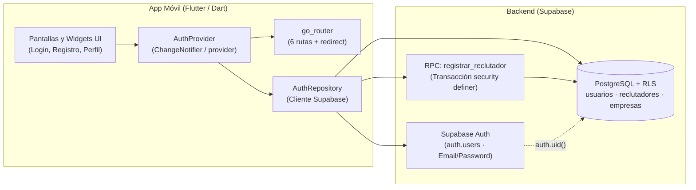

# DreamJob

> **El match laboral bidireccional donde el talento joven y las empresas conectan deslizando.**


-amber)

---

## 1. Descripción y propuesta de valor

**DreamJob** es una aplicación móvil construida con **Flutter/Dart** que aplica la mecánica de **Tinder** al mercado laboral y de prácticas profesionales:

1. **Perfiles y preferencias:** cada persona crea su perfil profesional y configura sus preferencias; las empresas y reclutadores registran su organización y sus oportunidades.
2. **Exploración ágil:** en la pantalla de búsqueda se presentan vacantes o prácticas (para candidatos) y perfiles compatibles (para empresas).
3. **Mecánica de swipe:** deslizar a la **derecha** indica *me interesa* (*like*) y deslizar a la **izquierda** permite *descartar* la tarjeta.
4. **Match bidireccional:** existe **match** únicamente cuando ambas partes se dan *like* mutuamente (candidato ↔ empresa/vacante), habilitando un canal directo y filtrado para continuar el proceso de selección.

**Visión a largo plazo (Roadmap):** incorporar un **agente de IA** que asista en la postulación a vacantes (adaptación de hoja de vida y carta de presentación, llenado de formularios, lectura de códigos OTP 2FA y bitácora de acciones), junto con seguimiento de postulaciones y entrevistas, sesiones de preparación con un *coach* y notificaciones en tiempo real.

---

## 2. Usuarios objetivo (User Personas)

### 👩‍💻 Valentina Rodríguez — Candidata / Estudiante
- **Perfil:** 21 años, Cali, Colombia. Estudiante de Ingeniería de Sistemas enfocada en desarrollo móvil (*mobile-first*).
- **Cita:** *"Quiero encontrar una oportunidad que se ajuste a mi perfil sin enviar mi hoja de vida a decenas de vacantes que no responden."*
- **Motivaciones:** conseguir su primera práctica o empleo junior, aplicar Flutter/Dart y sus proyectos académicos en un entorno real, y encontrar empresas con modalidad, horarios y cultura compatibles.
- **Frustraciones:** vacantes junior que exigen demasiada experiencia, ausencia de respuesta sobre el estado de sus postulaciones y ofertas con información incompleta (sin salario, modalidad ni beneficios claros).

### 🧑‍💼 Andrés Martínez — Reclutador / Empresa
- **Perfil:** 32 años, Cali, Colombia. Analista de selección tecnológica.
- **Cita:** *"Necesito identificar candidatos realmente compatibles sin invertir horas revisando perfiles que no cumplen los requisitos básicos."*
- **Motivaciones:** cubrir vacantes de prácticas y perfiles junior con agilidad, visualizar habilidades, disponibilidad y preferencias antes de contactar, y centralizar vacantes, perfiles, matches y mensajes en un solo lugar.
- **Frustraciones:** alto volumen de postulaciones irrelevantes que no cumplen requisitos mínimos, información dispersa entre portales, correo y hojas de cálculo, y perfiles incompletos difíciles de comparar.

---

## 3. Estado de funcionalidades

> **Nota de verificación:** el repositorio se encuentra al inicio del **Sprint 1**. Todo lo correspondiente a este sprint figura como **En desarrollo (Sprint 1)** hasta su integración en `dev`/`main`.

| Funcionalidad | Estado | Detalle |
|---|---|---|
| Registro de candidato con onboarding mínimo | 🚧 En desarrollo (Sprint 1) | Nombre, email, contraseña, ciudad, fecha de nacimiento y resumen opcional |
| Registro de reclutador con creación de empresa | 🚧 En desarrollo (Sprint 1) | Datos del reclutador + creación atómica de empresa (nombre, descripción, monograma) vía RPC |
| Inicio de sesión con email y contraseña | 🚧 En desarrollo (Sprint 1) | Supabase Auth sin confirmación de email y mapeo de errores al español |
| Resumen de perfil diferenciado por rol | 🚧 En desarrollo (Sprint 1) | Vista de datos del candidato (con edad calculada) o del reclutador (con tarjeta de empresa) |
| Sesión persistente y cierre de sesión | 🚧 En desarrollo (Sprint 1) | Redirección automática desde `/splash` según sesión activa en Supabase |
| Seguridad por fila (RLS) en base de datos | 🚧 En desarrollo (Sprint 1) | Políticas RLS en `empresas`, `usuarios` y `reclutadores` + función RPC `registrar_reclutador` |
| Inicio de sesión con Google y conexión con Gmail | 🗓️ Roadmap | Fuera del alcance del Sprint 1 (`google_sub`, OAuth tokens) |
| Preferencias laborales, habilidades, roles y hojas de vida | 🗓️ Roadmap | Seniority, salario mínimo, modalidades, tecnologías, bloqueo de empresas y puntaje ATS |
| Publicación de vacantes y recomendaciones con razones | 🗓️ Roadmap | Vacantes por empresa, puntos clave y motor de sugerencias con explicación del match |
| Motor de swipes (derecha/izquierda) y match bidireccional | 🗓️ Roadmap | Swipes de candidato y de reclutador/empresa, deshacer swipe y generación de matches |
| Agente de IA para postulaciones y documentos | 🗓️ Roadmap | Adaptación de CV/carta de presentación, respuestas a formularios, códigos OTP 2FA y log del agente |
| Seguimiento de postulaciones, entrevistas y *coach* | 🗓️ Roadmap | Estados de postulación, etapas de entrevista y llamadas de preparación/retroalimentación |
| Sistema de notificaciones | 🗓️ Roadmap | Alertas para candidatos y reclutadores sobre matches, postulaciones y entrevistas |

---

## 4. Arquitectura y stack tecnológico

### Stack del Sprint 1
- **Frontend móvil:** Flutter / Dart (SDK estable).
- **Gestión de estado:** [`provider`](https://pub.dev/packages/provider) (`ChangeNotifier` a través de `AuthProvider`).
- **Navegación declarativa:** [`go_router`](https://pub.dev/packages/go_router) con guardas de redirección (`redirect`) según el estado de sesión y rol.
- **Backend as a Service (BaaS):** [Supabase](https://supabase.com/) (`supabase_flutter`):
  - **Supabase Auth:** autenticación con email y contraseña (confirmación de correo desactivada para el entorno de desarrollo/demo).
  - **PostgreSQL + Row Level Security (RLS):** aislamiento por usuario (`auth.uid()`).
  - **Función RPC (`registrar_reclutador`):** función `security definer` en PL/pgSQL para crear empresa y reclutador en una única transacción.

### Diagrama de arquitectura (Sprint 1)



---

## 5. Modelo de datos

> [!IMPORTANT]
> **Alcance y tipos de datos del modelo:**
> 1. **Visión objetivo vs. Sprint 1:** el modelo relacional completo representa la **visión objetivo a largo plazo** de DreamJob. El **Sprint 1 implementa únicamente las tablas `empresas`, `usuarios` y `reclutadores`** (vinculadas a `auth.users` de Supabase) y la función RPC `registrar_reclutador`.
> 2. **Tipos Oracle vs. PostgreSQL:** el diagrama relacional de diseño utiliza tipos de **Oracle** (`VARCHAR2`, `NUMBER`, `CLOB`, `DATE`, `TIMESTAMP`), mientras que la implementación real se ejecuta sobre **PostgreSQL en Supabase** (`uuid`, `text`, `date`, `timestamptz`, `boolean`, `numeric`).

### 5.1. Entidades implementadas en el Sprint 1 (PostgreSQL / Supabase)

| Tabla / Objeto | Columnas principales (Contrato Sprint 1) | Seguridad (RLS / Permisos) |
|---|---|---|
| **`empresas`** | `id` (`uuid PK default gen_random_uuid()`), `nombre` (`text not null`), `descripcion` (`text`), `monograma` (`text not null`, 1–3 letras), `created_at` (`timestamptz`) | RLS activo. `SELECT` restringido a la empresa del reclutador autenticado. Sin `INSERT` directo (solo vía RPC). |
| **`usuarios`** *(Candidato)* | `id` (`uuid PK references auth.users(id) on delete cascade`), `nombre` (`text not null`), `email` (`text not null`), `ciudad` (`text not null`), `fecha_nacimiento` (`date not null`), `resumen_perfil` (`text`), `created_at` (`timestamptz`) | RLS activo. `SELECT`, `INSERT` y `UPDATE` permitidos únicamente cuando `id = auth.uid()`. |
| **`reclutadores`** | `id` (`uuid PK references auth.users(id) on delete cascade`), `nombre` (`text not null`), `email` (`text not null`), `empresa_id` (`uuid not null references empresas(id)`), `created_at` (`timestamptz`) | RLS activo. `SELECT` y `UPDATE` donde `id = auth.uid()`. Sin `INSERT` directo (solo vía RPC). |
| **RPC `registrar_reclutador`** | Parámetros: `p_nombre`, `p_email`, `p_empresa_nombre`, `p_empresa_descripcion`, `p_empresa_monograma` (`text`) | `security definer`, `set search_path = public`. Verifica `auth.uid() != null`, inserta en `empresas` y `reclutadores` en una sola transacción. `GRANT EXECUTE` solo a `authenticated`. |

### 5.2. Resumen de entidades del modelo objetivo completo (Roadmap)

| Dominio | Entidades del modelo relacional objetivo | Propósito en la visión de producto |
|---|---|---|
| **Identidad y perfil del candidato** | `usuarios`, `hojas_de_vida`, `roles_interes`, `usuario_roles_interes`, `tecnologias`, `usuario_tecnologias`, `usuario_modalidades`, `empresas_bloqueadas` | Datos personales, preferencias salariales y de modalidad, habilidades técnicas, bloqueo de empresas y gestión de CVs con puntaje ATS. |
| **Empresas y vacantes** | `empresas`, `reclutadores`, `vacantes`, `vacante_tecnologias` | Perfil corporativo, reclutadores asociados, ofertas laborales/prácticas (modalidad, rango salarial, fuente, método de envío y puntos clave) y stack requerido. |
| **Descubrimiento, swipes y match** | `recomendaciones`, `swipes`, `matches` | Sugerencias con razones de compatibilidad, registro de swipes (`derecha` / `izquierda`) tanto de candidato como de empresa (`actor`), y confirmación del match bidireccional. |
| **Postulaciones y agente de IA** | `postulaciones`, `documentos_postulacion`, `preguntas_formulario`, `codigos_otp`, `log_acciones_agente` | Flujo de aplicación desde un match o detalle, documentos adaptados (CV/carta con porcentaje de palabras clave), respuestas a preguntas, lectura de 2FA/OTP y auditoría del agente. |
| **Entrevistas, coaching y alertas** | `entrevistas`, `llamadas_coach`, `notificaciones` | Seguimiento de etapas de entrevista, sesiones de práctica/retroalimentación con puntaje y consejos de IA, y notificaciones para candidato y reclutador. |

---

## 6. Estructura del repositorio

- **Estado actual verificado en el repositorio:**
  ```text
  DreamJob/
  └── README.md
  ```

- **Estructura planeada para el Sprint 1 (*Por confirmar conforme se integren los PRs*):**
  ```text
  DreamJob/
  ├── README.md
  ├── supabase/
  │   └── schema.sql                           # [Planeado] Tablas, políticas RLS y RPC registrar_reclutador
  └── app/                                     # [Planeado] Proyecto Flutter
      ├── .env.example                         # [Planeado] Plantilla de variables de entorno (sin secretos)
      ├── pubspec.yaml                         # [Planeado] Dependencias: supabase_flutter, provider, go_router
      ├── lib/
      │   ├── main.dart                        # [Planeado] Inicialización de Supabase, MultiProvider y MaterialApp.router
      │   ├── core/
      │   │   └── validators.dart              # [Planeado] Validaciones en español (email, password, required, date)
      │   ├── router/                          # [Planeado] Configuración de las 6 rutas y redirección por sesión
      │   ├── auth/
      │   │   ├── data/                        # [Planeado] Modelos y AuthRepository
      │   │   ├── state/                       # [Planeado] AuthProvider (stub en memoria y proveedor real)
      │   │   ├── widgets/                     # [Planeado] AuthTextField, AuthPasswordField, AuthPrimaryButton, AuthErrorBanner
      │   │   └── screens/
      │   │       ├── login_screen.dart
      │   │       ├── register_role_screen.dart
      │   │       ├── register_candidate_screen.dart
      │   │       └── register_recruiter_screen.dart
      │   └── profile/
      │       └── profile_summary_screen.dart  # [Planeado] Resumen de perfil para candidato y reclutador
      └── test/                                # [Planeado] Tests de widgets (perfil y registro)
  ```

---

## 7. Primeros pasos (Instalación y ejecución)

> **Estado:** los archivos `app/`, `app/.env.example` y `supabase/schema.sql` se encuentran **Por confirmar** (pendientes de publicación en la rama `dev` durante el Sprint 1).

### 7.1. Requisitos previos
1. **Flutter SDK estable** instalado y en el `PATH`, con `flutter doctor` en verde.
2. **Android Studio** configurado con un emulador Android (AVD) o un **celular físico Android** con depuración por USB activa.
3. **Proyecto en Supabase** configurado con:
   - Opción **"Confirm email" desactivada** en `Authentication → Providers → Email`.
   - El script `supabase/schema.sql` (*Por confirmar*) ejecutado sin errores en el **SQL Editor** de Supabase.

### 7.2. Configuración paso a paso

1. **Clonar el repositorio:**
   ```bash
   git clone https://github.com/JuanJarias/DreamJob.git
   cd DreamJob
   ```

2. **Instalar dependencias de Flutter** (*Por confirmar tras creación de `app/`*):
   ```bash
   cd app
   flutter pub get
   ```

3. **Configurar variables de entorno** (*Por confirmar tras creación de `app/.env.example`*):
   Copia la plantilla `.env.example` a `.env` dentro de la carpeta `app/`:
   ```bash
   cp .env.example .env
   ```
   Edita `app/.env` y completa las credenciales del proyecto de Supabase (se comparten únicamente por canal privado al equipo):
   ```env
   SUPABASE_URL=https://<tu-proyecto>.supabase.co
   SUPABASE_ANON_KEY=<tu-anon-key>
   ```
   > ⚠️ **Seguridad:** el archivo `app/.env` está ignorado por Git. **Nunca** subas `.env`, tokens ni contraseñas al repositorio, issues o Pull Requests, y **nunca** utilices la `service_role` key en la aplicación.

4. **Ejecutar la aplicación** (con un emulador Android o dispositivo conectado):
   ```bash
   flutter run --dart-define-from-file=.env
   ```

---

## 8. Sprint 1 — Autenticación

### 8.1. Alcance del Sprint 1
El Sprint 1 entrega el flujo completo de autenticación y onboarding inicial para los dos roles del sistema (**Candidato** y **Reclutador**):
- Registro de cuenta con validación de campos en español.
- Creación de perfil de candidato en `usuarios` o creación transaccional de empresa + reclutador mediante la función RPC `registrar_reclutador`.
- Inicio de sesión con correo electrónico y contraseña (`supabase_flutter`).
- Pantalla de resumen de perfil adaptada dinámicamente según `UserRole` (`candidato` o `reclutador`).
- Persistencia de sesión al cerrar y reabrir la aplicación, y cierre de sesión seguro.
- *Fuera del alcance del Sprint 1:* inicio de sesión con Google y conexión con Gmail.

### 8.2. Mapa de rutas (`go_router`)

| Ruta | Pantalla (`Clase`) | Archivo planeado | Descripción |
|---|---|---|---|
| `/splash` | Splash / Carga inicial | `app/lib/router/...` (*Por confirmar*) | Verifica si existe sesión activa (`currentSession`) y redirige a `/profile` o `/login`. |
| `/login` | `LoginScreen` | `app/lib/auth/screens/login_screen.dart` | Inicio de sesión con email y contraseña, banner de error y enlace a `/register`. |
| `/register` | `RegisterRoleScreen` | `app/lib/auth/screens/register_role_screen.dart` | Selector "¿Cómo quieres usar DreamJob?" con tarjetas para Candidato y Reclutador. |
| `/register/candidato` | `RegisterCandidateScreen` | `app/lib/auth/screens/register_candidate_screen.dart` | Formulario de candidato: nombre, email, contraseña (≥ 8), confirmación, ciudad, fecha de nacimiento y resumen opcional (máx. 280 caracteres). |
| `/register/reclutador` | `RegisterRecruiterScreen` | `app/lib/auth/screens/register_recruiter_screen.dart` | Formulario en dos secciones: "Tus datos" (nombre, email, contraseña, confirmación) y "Tu empresa" (nombre, descripción máx. 280 caracteres y monograma de 1 a 3 letras en mayúsculas con vista previa). |
| `/profile` | `ProfileSummaryScreen` | `app/lib/profile/profile_summary_screen.dart` | Muestra los datos del candidato (con edad calculada) o del reclutador (con tarjeta y monograma de empresa) y el botón "Cerrar sesión". |

### 8.3. Pasos de demostración por rol

#### Flujo A — Candidato
1. Abrir la app en `/login` y pulsar **"¿No tienes cuenta? Crear cuenta"** (navega a `/register`).
2. Seleccionar la tarjeta **"Soy candidato"** (navega a `/register/candidato`).
3. Completar nombre completo, correo electrónico, contraseña (mínimo 8 caracteres) y su confirmación, ciudad, fecha de nacimiento y resumen de perfil (opcional), y pulsar **"Crear cuenta"**.
4. Verificar que el router redirige automáticamente a `/profile` mostrando avatar con iniciales, nombre, correo, ciudad, fecha de nacimiento con edad calculada y resumen.
5. Pulsar **"Cerrar sesión"** y verificar el retorno automático a `/login`.
6. Iniciar sesión nuevamente con el correo y contraseña recién creados y confirmar la llegada a `/profile`.
7. Cerrar por completo la aplicación y volver a abrirla: `/splash` detecta la sesión activa y entra directo a `/profile`.

#### Flujo B — Reclutador
1. Desde `/login`, pulsar **"Crear cuenta"** y elegir la tarjeta **"Soy reclutador"** (navega a `/register/reclutador`).
2. Completar la sección **"Tus datos"** (nombre, correo, contraseña y confirmación) y la sección **"Tu empresa"** (nombre de la empresa, descripción y monograma de 1 a 3 letras verificando la vista previa), y pulsar **"Crear cuenta"**.
3. Verificar la redirección automática a `/profile`, donde se visualizan los datos del reclutador junto con la tarjeta de su empresa (monograma, nombre y descripción).
4. Pulsar **"Cerrar sesión"** (regresa a `/login`), volver a iniciar sesión con las mismas credenciales y comprobar el perfil.
5. Cerrar y reabrir la aplicación para comprobar que la sesión del reclutador persiste en `/profile`.

### 8.4. Errores esperables y manejo en interfaz
Todos los mensajes de validación y errores de Supabase se presentan en **español**:

| Caso de error | Comportamiento esperado en la app |
|---|---|
| **Email repetido (ya registrado)** | `AuthProvider.error` muestra en el `AuthErrorBanner` que el correo electrónico ya se encuentra registrado. |
| **Credenciales incorrectas** | Al fallar `signIn`, se muestra en el banner que el correo o la contraseña son incorrectos. |
| **Contraseña corta (< 8 caracteres)** | `Validators.password` impide el envío y muestra el error bajo el campo indicando el mínimo de 8 caracteres. |
| **Campos obligatorios vacíos** | `Validators.required` / `Validators.date` señala cada campo faltante debajo del control correspondiente sin llamar a Supabase. |
| **Sin conexión a internet** | Al intentar autenticarse en modo avión o sin red, se captura la excepción y se informa en español el problema de conexión. |

---

## 9. Cómo contribuir

### Flujo de ramas
- **`main`:** rama de entregas oficiales (solo recibe merges desde `dev` para versiones etiquetadas como `v1.0.0`).
- **`dev`:** rama de integración continua del equipo.
- **Ramas de trabajo (`feat/...`, `docs/...`, `fix/...`, `chore/...`, `test/...`):** todo cambio se desarrolla en una rama específica (por ejemplo, `feat/nucleo-auth`, `feat/ui-login-registro`, `feat/ui-reclutador-perfil`) y se integra mediante **Pull Request hacia `dev`**.
- **Reglas estrictas:**
  - Prohibido hacer push directo a `main` o `dev` sin flujo aprobado.
  - Prohibido usar `git push --force`.
  - Mantener la rama actualizada antes de trabajar (`git checkout dev && git pull` y luego integrar en la rama propia).

### Convención de commits
Commits atómicos, en español y de **una sola línea**, utilizando uno de los siguientes prefijos:
- `feat:` nueva funcionalidad (ej. `feat: pantalla de login con validaciones`).
- `fix:` corrección de un defecto.
- `docs:` cambios únicamente en documentación.
- `chore:` configuración, dependencias o tareas de mantenimiento.
- `test:` creación o ajuste de pruebas automatizadas.

### Criterios de calidad para cada Pull Request
Antes de abrir o aprobar un PR hacia `dev`, se debe verificar dentro de `app/`:
```bash
flutter analyze   # Sin errores ni warnings
flutter test      # Todos los tests pasando
```
- Todos los textos visibles y mensajes de error deben estar en **español**.
- Ningún archivo de credenciales (`.env`), token o contraseña puede incluirse en el commit.

*(La guía detallada `CONTRIBUTING.md`, la plantilla de PR y el flujo de CI se encuentran planeados dentro del Sprint 1).*

---

## 10. Roadmap

| Etapa | Alcance | Estado |
|---|---|---|
| **Sprint 1** | Autenticación (Candidato y Reclutador), registro con empresa, resumen de perfil, sesión persistente y RLS en Supabase (`v1.0.0`). | 🚧 En desarrollo (Entrega: 1 de noviembre de 2026) |
| **Sprint 2** | *Por definir* (candidato a incluir configuración de preferencias, catálogo de tecnologías/roles y publicación de vacantes). | 🗓️ Por definir |
| **Sprint 3** | *Por definir* (candidato a incluir exploración con tarjetas, swipes derecha/izquierda y match bidireccional). | 🗓️ Por definir |
| **Sprints futuros** | *Por definir* (agente de IA para postulaciones y documentos, seguimiento de entrevistas, llamadas con *coach* y notificaciones). | 🗓️ Por definir |

---

## 11. Equipo y licencia

### Equipo de desarrollo
- **Joshua Rivera** ([@JRivera340](https://github.com/JRivera340)) — Núcleo, arquitectura Flutter, integración con Supabase, router y entrega.
- **Juan José Arias** ([@JuanJarias](https://github.com/JuanJarias)) — UI de entrada (Login, selector de rol, registro de candidato) y widgets compartidos de autenticación.
- **Ange** ([@Angdicode](https://github.com/Angdicode)) — UI de registro de reclutador, pantalla de resumen de perfil por rol y pruebas de widgets.

### Licencia
- **Por confirmar** *(actualmente no existe un archivo `LICENSE` en el repositorio)*.
